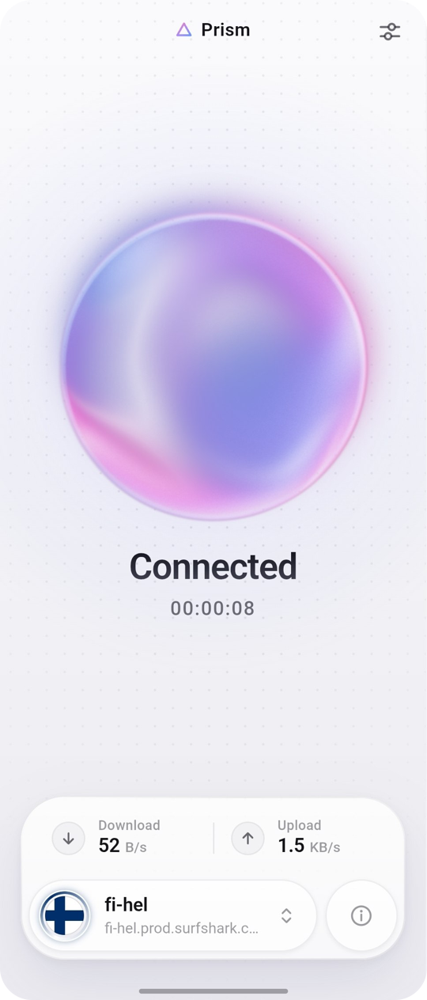

  

<h1 align="center">Prism</h1>

  Full bypass of TSPU checks for WireGuard. 
  <a href="README.md">Русский</a> · <b>English</b>

  
  

  
  

Prism is a simple app for macOS, Windows and Android that connects to any WireGuard server, even where WireGuard is blocked. Add a config, press the orb, and you're done.

## How to use

1. Install Prism.
2. Add a WireGuard config from your VPN service or your own server.
3. Press the orb.

On first connect, macOS asks for your administrator password once so Prism can set up networking. Android asks for VPN permission, then to run in the background without battery limits so the connection survives the phone sleeping.

On Android the APK is installed by hand: open the downloaded file and allow installs from that source.

## Download

The latest version for macOS, Windows and Android is on the [Releases](https://github.com/vlppz/prism/releases/latest) page.

## Features

- **Gets past WireGuard blocking.** Prism disguises the connection so your provider doesn't cut it. There's nothing to set up, and the server stays plain WireGuard.
- **Any WireGuard config.** Drop a `.conf` file into the window, pick one, or paste its text. On a phone, also a QR code: with the camera or from a picture.
- **Smart routing.** Russian sites open directly, everything else goes through the VPN. Turn it on or off in Settings.
- **One button.** Connection, speed and session time on one screen, server details behind the ⓘ button.
- **Tells you what's wrong.** If a server doesn't answer or its address is blocked, Prism says so.
- **Light and dark themes.** Follows the system or set by hand.
- **Lives in the tray.** Closing the window doesn't drop the VPN.
- **At home on Android.** A Quick Settings tile, a notification with speed and a Disconnect button, and a VPN that doesn't fall asleep with the phone.

## Requirements

- macOS 11 or later (Apple Silicon and Intel)
- Windows 10 or 11 (64-bit)
- Android 7.0 or later (smart routing needs Android 13)
