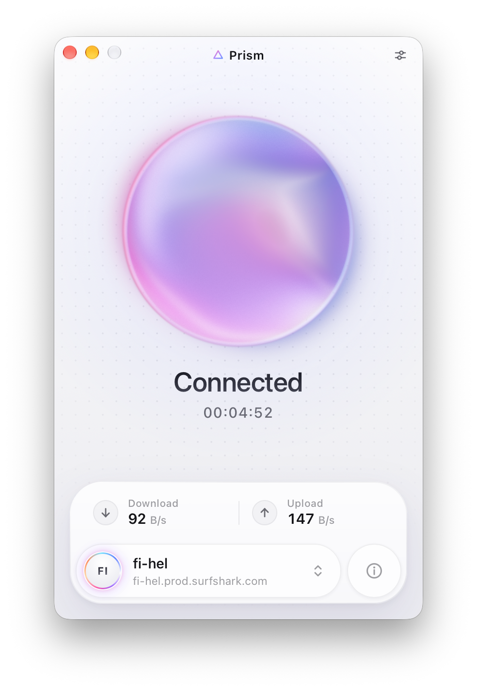
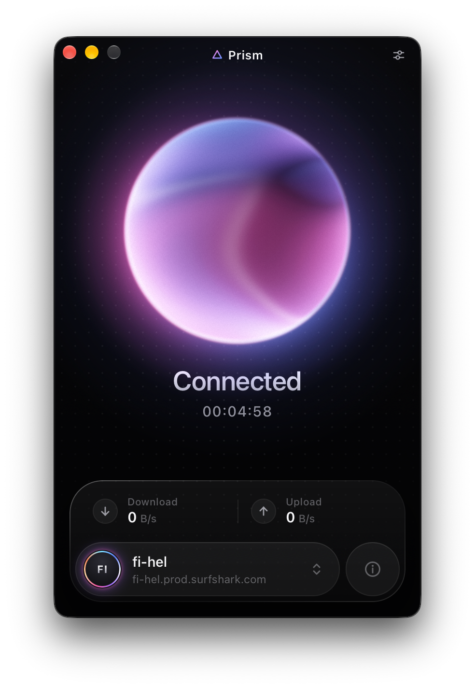

  

<h1 align="center">Prism</h1>

  WireGuard that gets through. 
  <a href="README.md">Русский</a> · <b>English</b>

  
  

Prism is a simple app for macOS and Windows that connects to any WireGuard server, even where WireGuard is blocked. Add a config, press the orb, and you're done.

## Features

- **Gets past WireGuard blocking.** Prism disguises the connection so your provider doesn't cut it. There's nothing to set up, and the server stays plain WireGuard.
- **Any WireGuard config.** Drop a `.conf` file into the window, pick one, or paste its text.
- **Smart routing.** Russian sites open directly, everything else goes through the VPN. Turn it on or off in Settings.
- **One button.** Connection, speed and session time on one screen, server details behind the ⓘ button.
- **Tells you what's wrong.** If a server doesn't answer or its address is blocked, Prism says so.
- **Light and dark themes.** Follows the system or set by hand.
- **Lives in the tray.** Closing the window doesn't drop the VPN.

## How to use

1. Install Prism.
2. Add a WireGuard config from your VPN service or your own server.
3. Press the orb.

On first connect, macOS asks for your administrator password once so Prism can set up networking.

## Requirements

- macOS 11 or later (Apple Silicon)
- Windows 10 or 11 (64-bit)
