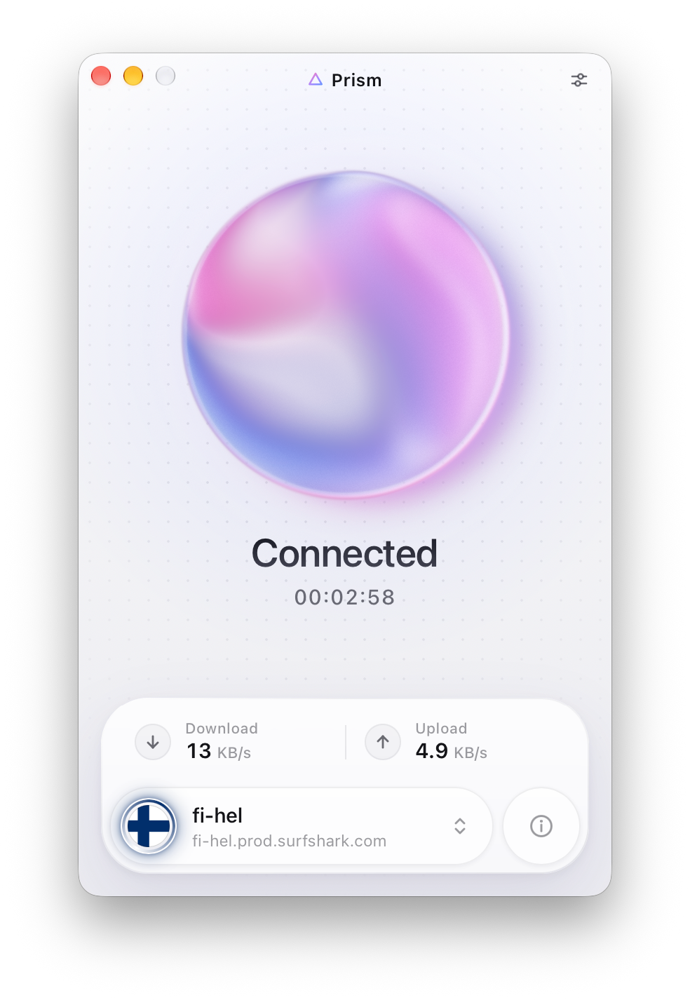
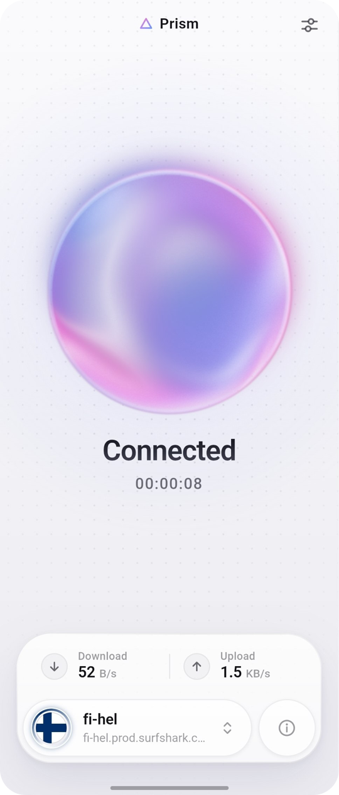
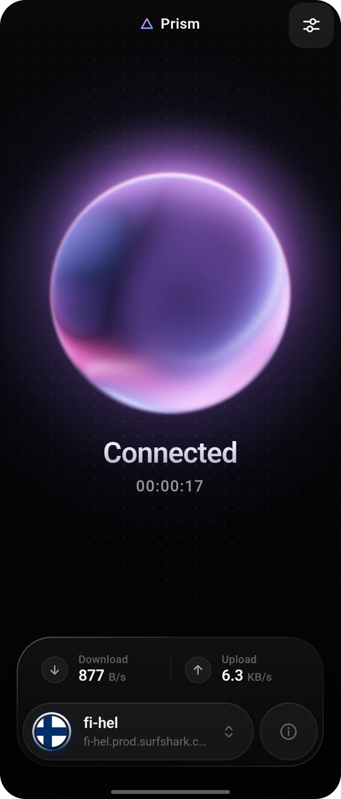

  

<h1 align="center">Prism</h1>

  Полный обход проверок ТСПУ для WireGuard. 
  <b>Русский</b> · <a href="README.en.md">English</a>

  
  

  
  

Prism — простое приложение для macOS, Windows и Android, которое подключается к любому серверу WireGuard там, где WireGuard блокируют. Добавьте конфиг, нажмите на шар — и всё.

## Как пользоваться

1. Установите Prism.
2. Добавьте конфиг WireGuard, полученный от вашего VPN-сервиса или со своего сервера.
3. Нажмите на шар.

При первом подключении на macOS Prism один раз попросит пароль администратора, чтобы настроить сеть. На Android он попросит разрешение на VPN, а затем — работу в фоне без ограничений батареи, чтобы соединение не обрывалось во сне.

На Android APK ставится вручную: откройте скачанный файл и разрешите установку из этого источника.

## Скачать

Последняя версия для macOS, Windows и Android — на странице [Releases](https://github.com/vlppz/prism/releases/latest).

## Возможности

- **Обход блокировок WireGuard.** Prism маскирует подключение, чтобы провайдер его не обрывал. Ничего настраивать не нужно, а сервер остаётся обычным WireGuard.
- **Любой конфиг WireGuard.** Перетащите файл `.conf` в окно, выберите его или вставьте текст. На телефоне — ещё и QR-код: камерой или картинкой из галереи.
- **Умная маршрутизация.** Российские сайты открываются напрямую, всё остальное идёт через VPN. Включается и выключается в настройках.
- **Одна кнопка.** Подключение, скорость и время сессии — на одном экране, подробности о сервере — по кнопке ⓘ.
- **Подсказки, когда что-то не так.** Если сервер не отвечает или его адрес заблокирован, Prism так и скажет.
- **Светлая и тёмная тема.** Следует системной или выбирается вручную.
- **Живёт в трее.** Закрытое окно не обрывает VPN.
- **На Android — как дома.** Плитка в быстрых настройках, уведомление со скоростью и кнопкой «Отключить», VPN не засыпает вместе с телефоном.

## Системные требования

- macOS 11 или новее (Apple Silicon и Intel)
- Windows 10 или 11 (64-бит)
- Android 7.0 или новее (умная маршрутизация — с Android 13)
